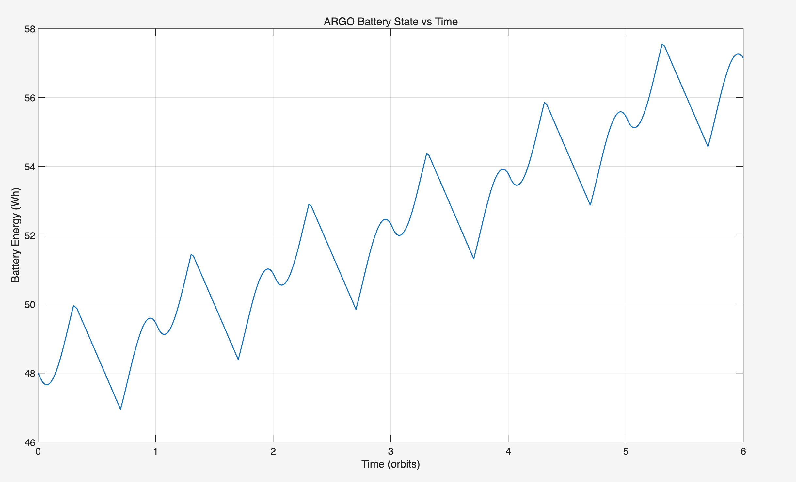
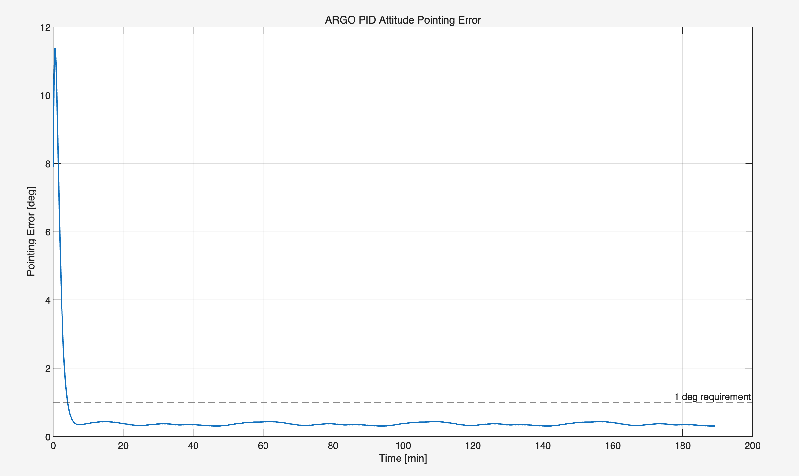

# ARGO · 6U CubeSat Space Segment Design

**Mission-driven spacecraft subsystem modelling in MATLAB and Princeton Satellite Systems SCT.**

A portfolio of a preliminary CubeSat design developed for **UNSW AERO9610 — The Space Segment, T1 2026**. ARGO (Autonomous Rendezvous and Guidance Observer) explores the spacecraft bus needed to support stereo-vision observation of uncooperative debris in low Earth orbit.

[中文说明](README.zh-CN.md) · [Interview guide / 面试讲解](docs/INTERVIEW.zh-CN.md) · [Assessment traceability](docs/ASSESSMENT.md) · [Run guide](docs/REPRODUCIBILITY.md) · [Evidence and limitations](docs/LIMITATIONS.md)

## Engineering question

How can a 6U spacecraft support an optical payload when pointing, eclipse energy, thermal rejection, storage and intermittent ground contact constrain one another?

This project develops orbit, structure, thermal, power, attitude-control and communication studies around that question. The repository contains mission-specific scripts and historical results. The vision-processing payload is a **mission concept**: a vSLAM implementation, closed-loop rendezvous controller and flight-qualified spacecraft are outside the implemented scope.

## Design baseline

| Item | Final-report design intent |
|---|---|
| Spacecraft | 6U, 10 × 20 × 30 cm, approximately 9 kg |
| Orbit | 500 km near-circular SSO concept; approximately 94.6 min period |
| Payload | Stereo cameras + VPU; 1.8 kg and 12 W peak combined |
| Power | Deployable solar arrays; 60 Wh Li-ion battery |
| ADCS | Four-wheel quaternion PID study; pointing requirement < 1° |
| Data handling | 8 GB storage; approximately 533 MB/day assumed processed data |
| Communication | 2.26 GHz S-band, 2 W RF, 1.2 Mbps operational downlink |

These are design assumptions and report claims, not hardware measurements. Scripts retain historical parameter differences, including 97.4° versus 97.6° inclination. See the [version map](docs/VERSIONS.md).

## Selected original evidence

<table>
<tr><td></td><td></td></tr>
<tr><td>Final report, Fig. 7: battery energy approximately 48 → 57 Wh over six orbits.</td><td>Final report, Fig. 8: reported settling below 1° in about four minutes.</td></tr>
</table>

Figures were extracted from the original final report; the plots and their data were not redrawn. They are historical evidence, not results from a new run. The report's ADCS trace and the current script's initial condition differ; reproduction remains unverified. [Full evidence gallery](docs/RESULTS.md)

## Where to start

1. Read the [assessment-to-evidence map](docs/ASSESSMENT.md) for the engineering scope.
2. Browse [`code/final/`](code/final/) for the final subsystem scripts; `FinalADCS.m` is the most self-contained entry point.
3. Read the [run guide](docs/REPRODUCIBILITY.md) before executing the SCT-dependent examples.
4. Use the [Chinese interview guide](docs/INTERVIEW.zh-CN.md) to explain design choices, evidence and limitations.

```text
code/
  final/                    Final report's seven MATLAB files
  final-development/        Alternative communication/control and parameter work
  draft/                    Earlier mission/structure/thermal/power work
  integration-development/  Two ARGO files recovered from the toolbox root
assets/report-figures/       Original report images
data/original/              Two unchanged historical MAT files
docs/                      Assessment, results, run and interview guides
provenance/                SHA-256 records and verification status
tools/verify_integrity.py   Read-only byte-integrity check
```

## Preservation and validation

All 17 published `.m` files and both `.mat` files are byte-for-byte copies. Original names are preserved within each version directory. No models, coefficients, outputs or original reports were edited. An integrity verifier checks the copies and extracted figures:

```bash
python3 tools/verify_integrity.py
```

MATLAB R2025b was detected locally, but the attempted batch launch exited with status 1 and no diagnostic output. Simulation execution therefore remains **unverified**. Integrity verification does not validate physical correctness. See [validation status](provenance/VALIDATION.md).

## Attribution and scope

The project adapts the course's SCT-based workflow. PSS SCT provides modelling, propagation, environment and visualisation utilities; these are not claimed as original implementations. The full toolbox, course teaching material, third-party papers and two files with explicit PSS copyright headers are excluded from this publication package. [Attribution and dependency notes](THIRD_PARTY_NOTICES.md)

This is an academic portfolio snapshot, with no blanket open-source licence assigned. Packaging and explanatory documents were prepared with AI assistance; they do not change the original assessment submissions. [GitHub upload guide](docs/GITHUB.zh-CN.md)
