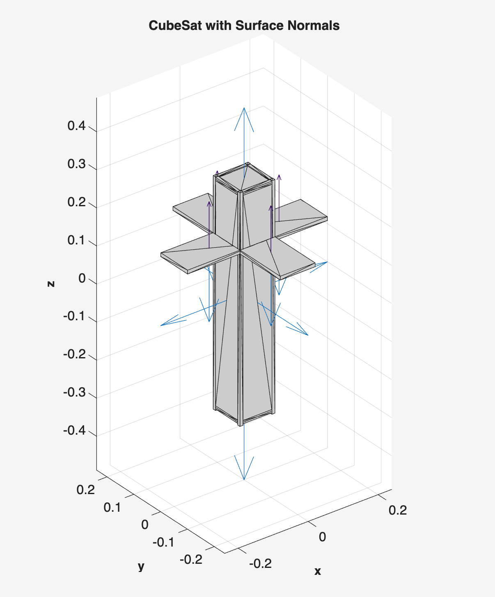
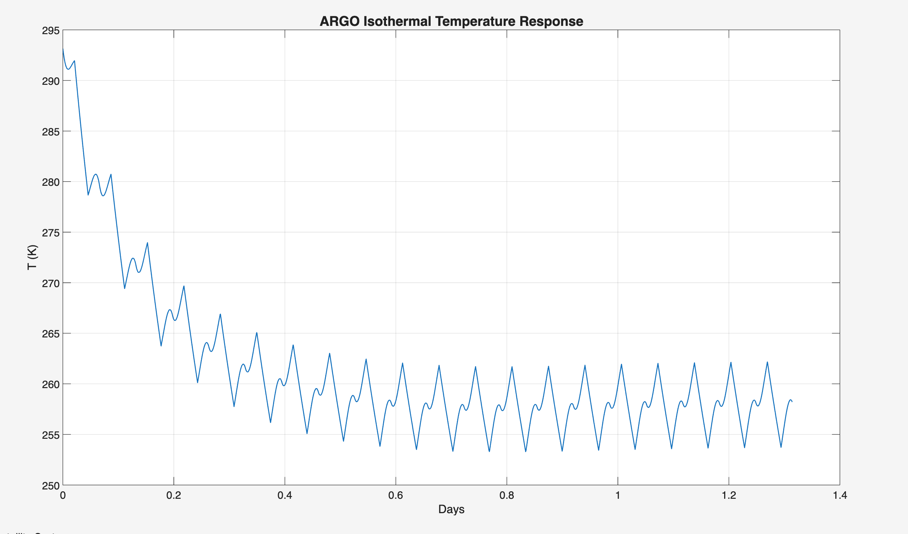
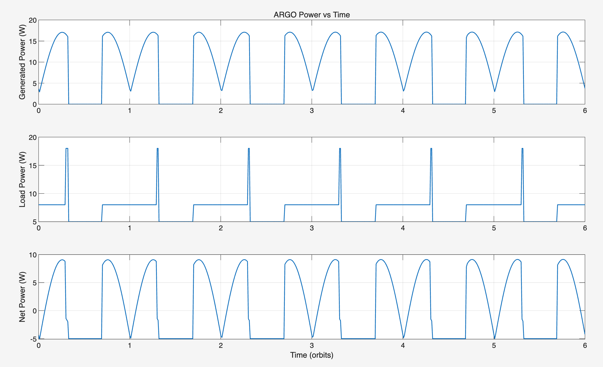
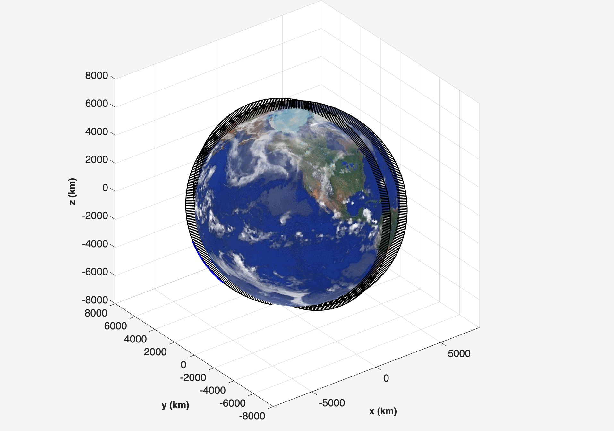
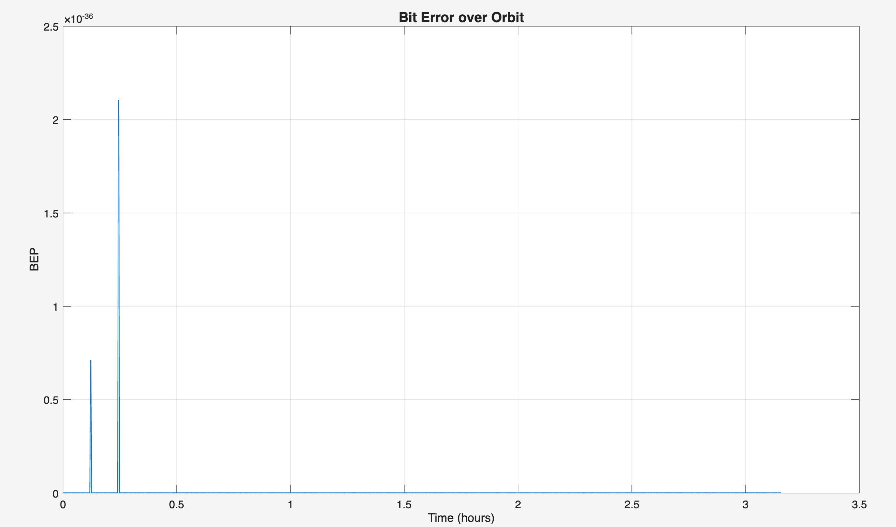
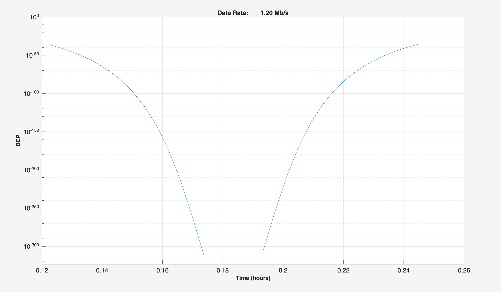

# Original report evidence

All images below were extracted from the final assessment PDF, preserving the embedded image output without redrawing, smoothing or recomputing the curves. SHA-256 and PDF page mappings are in [report-figures.json](../provenance/report-figures.json). Approximate values are reported or read from the original report, not independently reproduced measurements.

## Structure — Fig. 3, PDF p. 6

A bus and deployed-panel visualisation. This is not evidence of launch vibration qualification or a complete hardware assembly model.

## Thermal — Fig. 5, PDF p. 9

The report describes a settled cycle of about 253.5–262 K after starting near 293 K. That is roughly −19.7 to −11.2 °C; suitability for each battery/electronics component has not been demonstrated. The report's eclipse equilibrium arithmetic is inconsistent with its displayed formula. See [technical limits](LIMITATIONS.md).

## Power — Figs. 6–7, PDF pp. 11–12

The report shows approximately 17 W peak generation and a battery-energy increase from about 48 to 57 Wh over six orbits. The conclusion is specific to that model and operating schedule; it is not a claim of lifetime energy closure.

## ADCS — Fig. 8, PDF p. 14

The report states that the error falls below 1° in about four minutes and stays near 0.3–0.5°. The figure starts near 11°, while the current script's `[6; -4; 3]` Euler-angle initialisation corresponds to about 7.9° total rotation. An exact script-to-figure match is not established.

## Communication — Figs. 9–11, PDF pp. 16–17

The last image retains its original plot title, “Data Rate 1.20 Mb/s”, but its vertical axis is BEP. It must not be interpreted as a measured variable data-rate curve. `FinalCDH.m` separately calls the SCT data-rate and BEP utilities. The figure itself is preserved as found.

A designed two-orbit pass demonstrates a link scenario, not 59.2 minutes/day of operational contact. Off-contact BEP values must be interpreted alongside visibility; a zero or very small BEP by itself does not imply communication is available.

## Saved MAT files

[`data/original/`](../data/original/) contains two existing communication results files from the draft-code folder. They are preserved as historical binary outputs. A matching generating revision and exact correspondence to the final report have not been verified. The final-report images are a separate evidence source.
